# VulnScout

[](https://github.com/HeikoHan72/vulnscout/actions/workflows/ci.yml)

**Status: Abschlussprojekt Modul 6 – AI Engineer Lehrgang, MLOps & Deployment (Stand 25.11.2026)**

Multi-Agenten-System, das Code-Repositories automatisch auf Sicherheitslücken scannt, die Funde mit einem LLM bewertet (Fehlalarme filtert, Schweregrad einstuft) und einen lesbaren Bericht mit Fix-Vorschlägen erstellt.

Multi-agent system that scans code repositories for security vulnerabilities, uses an LLM to triage the findings (filtering false positives, scoring severity) and produces a readable report with fix suggestions.

## MLOps-Überblick / MLOps overview

| Baustein | Umsetzung | Details |
|---|---|---|
| Experiment-Tracking | MLflow (eigener Compose-Dienst) | [Pre-Filter-Modell](#pre-filter-modell--kostenersparnis) |
| Modell-Versionierung | MLflow Model Registry, Version 1 bis 6, Aliase `champion` (v6) und `challenger` (v5) | [Pre-Filter-Modell](#pre-filter-modell--kostenersparnis) |
| Qualitäts-Gate | Kandidat wird nur Champion bei Fehlerrate unter 2 % auf den automatisch entschiedenen Test-Funden; derselbe Test läuft in pytest | [Architektur](docs/architecture.md) |
| Monitoring | Prometheus und Grafana, 7 Alarmregeln (ohne Alertmanager, nur in der Prometheus-Oberfläche sichtbar) | [Monitoring](#monitoring) |
| Container | Docker, Docker Compose (API, MLflow, Prometheus, Grafana) | [Schnellstart](#schnellstart--quickstart) |
| Automatisierte Tests | pytest; GitHub Actions `CI` führt sie bei jedem Push und Pull Request auf `main` aus (Python 3.11) | [Tech-Stack](#tech-stack) |
| Deployment | Render (kostenlose Stufe), nur Demo-Modus; Auto-Deploy bei neuem Commit, nicht Teil der CI (`ci.yml` enthält keinen Deploy-Schritt) | [Online-Demo](#online-demo--online-demo) |

Die CI führt ausschließlich die Tests aus. Sie baut kein Docker-Image und deployt nichts. Das Deployment auf Render ist eine eigene Funktion von Render und keine Stufe der CI-Pipeline. / The CI only runs the tests; it builds no Docker image and deploys nothing. The Render deployment is a separate Render feature, not a stage of the CI pipeline.

## Schnellstart / Quickstart

```bash
cp .env.example .env
# ANTHROPIC_API_KEY in .env eintragen (optional, siehe Demo-Modus unten)
docker compose up
```

Voraussetzungen / Requirements: Docker mit Docker Compose und Internetzugang (pip-audit, das Semgrep-Regelwerk `p/security-audit` und die OSV-Anreicherung greifen auf das Netz zu). Getestet unter Linux; Windows und macOS sind nicht getestet. / Docker with Docker Compose and internet access (pip-audit, the Semgrep ruleset `p/security-audit` and the OSV enrichment use the network). Tested on Linux only.

API-Doku / API docs: http://localhost:8000/docs

**Demo-Modus / Demo mode:** Ohne `ANTHROPIC_API_KEY` läuft das System automatisch im Demo-/Fixture-Modus – deterministische Triage- und Report-Ergebnisse ohne LLM-Aufruf, sodass jeder das Projekt ohne eigenen API-Key ausprobieren kann. Der Modus lässt sich über `demo_mode: true/false` im `POST /scans`-Request auch explizit erzwingen.

Without an `ANTHROPIC_API_KEY`, the system automatically runs in demo/fixture mode – deterministic triage and report results with no LLM call, so anyone can try the project without their own API key. The mode can also be forced explicitly via `demo_mode: true/false` in the `POST /scans` request.

**Pre-Filter-Modell trainieren / Train the pre-filter model:** Nach dem Klonen liegt noch kein Modell in der MLflow Registry. Ohne Modell läuft VulnScout trotzdem, schickt aber jeden Fund an die LLM-Triage. Zum Trainieren, bei laufendem `docker compose up`, in einem zweiten Terminal (Python 3.11, Linux/macOS):

```bash
python -m venv .venv && source .venv/bin/activate
pip install -r requirements.txt
python -m scripts.train_prefilter
docker compose restart api   # nur nötig, wenn vorher schon ein Scan lief
```

Das Training nutzt den mitgelieferten Datensatz `scripts/training_data.jsonl` (3.004 Funde, 1,4 MB), braucht keinen API-Key und registriert den Champion in der MLflow Registry. Der API-Prozess lädt das Modell beim ersten Scan und merkt sich ein fehlendes Modell bis zum Neustart – daher der `restart`.

After cloning, the MLflow registry holds no model yet. VulnScout still runs without one but sends every finding to the LLM triage. To train it, run the commands above in a second terminal while `docker compose up` is running. Training uses the bundled dataset `scripts/training_data.jsonl` (3,004 findings, 1.4 MB), needs no API key and registers the champion in the MLflow registry. The API process loads the model on the first scan and remembers a missing model until restart, hence the `restart`.

## Online-Demo / Online demo

**URL:** https://vulnscout-0i2g.onrender.com/docs (Swagger-Oberfläche der API)

Die Demo läuft auf Render (kostenlose Stufe, Region Frankfurt) aus demselben Code und demselben Dockerfile wie der lokale Stack. Sie läuft **ausschließlich im Demo-Modus**: Die Scanner (Bandit, pip-audit, Semgrep) und die OSV-Anreicherung laufen echt, Triage und Bericht kommen aber aus Fixtures, nicht von Claude. Pre-Filter und MLflow Registry werden nicht angesprochen. Den vollständigen Ablauf mit LLM-Triage, Pre-Filter, Prometheus und Grafana gibt es nur lokal mit `docker compose up` (siehe Quickstart). Gründe: Auf einer öffentlichen URL ohne Authentifizierung soll kein API-Key liegen, und die kostenlose Stufe (512 MB RAM, 0,1 CPU, kein privates Netzwerk für eingehende Verbindungen) trägt den Compose-Stack nicht.

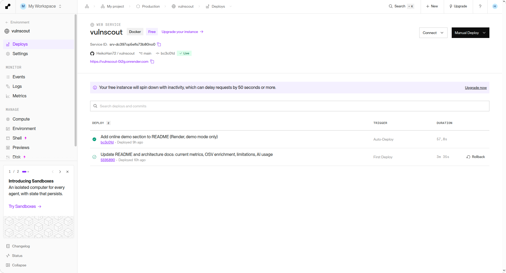

*Render (kostenlose Stufe), Dienst `vulnscout`, Docker, Commit bc3c01d, Status Live. Zwei Deploys: Erstdeploy 3 min 35 s, Auto-Deploy 57,8 s (Stand 25.11.2026). / Render (free tier), service `vulnscout`, Docker, commit bc3c01d, status Live. Two deploys: first deploy 3 min 35 s, auto-deploy 57.8 s (25 Nov 2026).*

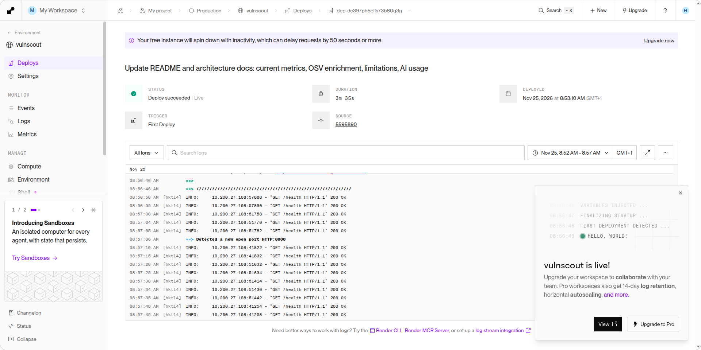

*Log des Erstdeploys (5595890): Port 8000 erkannt, danach Health-Checks mit `200 OK`. / Log of the first deploy (5595890): port 8000 detected, then health checks returning `200 OK`.*

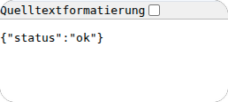

*`GET /health` der Online-Demo. / `GET /health` of the online demo.*

So probierst du es aus: `POST /scans` aufklappen, **Try it out**, dann diesen Request senden:

```json
{
  "repo_path": "/app/test_repos/dummy_vuln_repo",
  "demo_mode": true
}
```

Oder per Kommandozeile:

```bash
curl -X POST https://vulnscout-0i2g.onrender.com/scans \
  -H "Content-Type: application/json" \
  -d '{"repo_path": "/app/test_repos/dummy_vuln_repo", "demo_mode": true}'
```

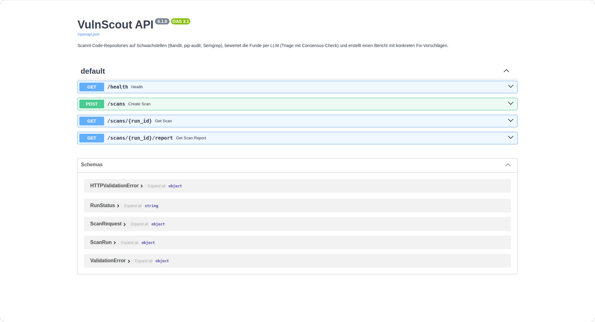

*Swagger-Oberfläche der Online-Demo mit vier Endpunkten. Die Beschreibung erwähnt die LLM-Bewertung, die in der Demo nicht stattfindet. / Swagger UI of the online demo with four endpoints. The description mentions the LLM assessment, which does not take place in the demo.*

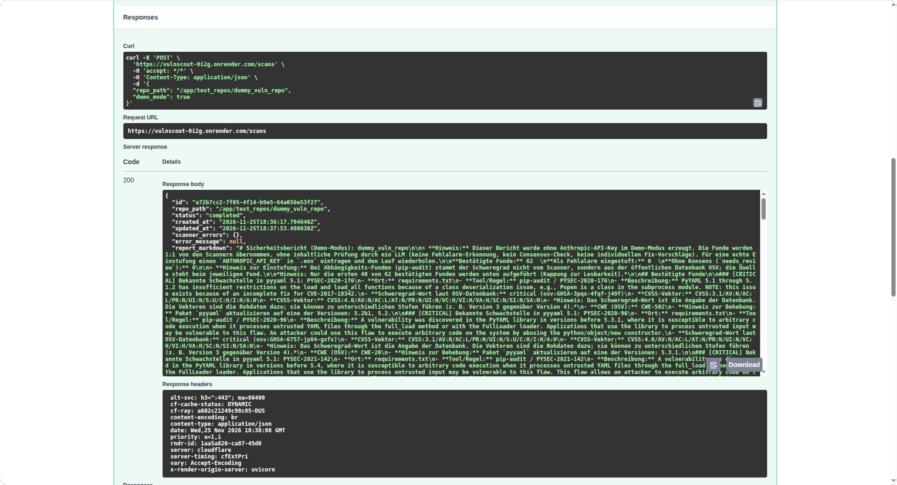

*Antwort des Demo-Scans (Demo-Modus, `dummy_vuln_repo`): Status completed, 62 Funde, keine Scanner-Fehler, `updated_at` 96 s nach `created_at`, die Antwort kam nach etwa 110 s. / Response of the demo scan (demo mode, `dummy_vuln_repo`): status completed, 62 findings, no scanner errors, `updated_at` 96 s after `created_at`, the response arrived after about 110 s.*

Zu wissen:
- Nach 15 Minuten ohne Aufruf schläft der Dienst ein; der erste Aufruf danach braucht rund eine Minute.
- Ein Scan läuft synchron und dauert hier rund zwei Minuten (zwei Läufe gemessen: etwa 110 und 112 s bis zur Antwort). Die Anfrage nicht wiederholen, bevor die Antwort da ist.
- Es lassen sich nur die mitgelieferten Beispiel-Repos unter `/app/test_repos` scannen.
- Die Datenbank ist nicht dauerhaft; Scan-Ergebnisse gehen beim Neustart des Dienstes verloren.
- Die Beschreibung oben in der Swagger-Oberfläche erwähnt die LLM-Bewertung; in der Demo gilt sie nicht. Der Bericht kennzeichnet sich selbst als Demo-Modus.
- Die Verfügbarkeit ist nicht garantiert (kostenlose Stufe).

The demo runs on Render (free tier, Frankfurt region) from the same code and Dockerfile as the local stack. It runs **in demo mode only**: the scanners (Bandit, pip-audit, Semgrep) and the OSV enrichment run for real, but triage and report come from fixtures, not from Claude. The pre-filter and the MLflow registry are not used. The full pipeline with LLM triage, pre-filter, Prometheus and Grafana runs locally only via `docker compose up` (see Quickstart). Reasons: no API key should sit on a public URL without authentication, and the free tier (512 MB RAM, 0.1 CPU, no inbound private networking) cannot carry the compose stack.

To try it, expand `POST /scans`, click **Try it out** and send the request above, or use the `curl` command above.

Good to know: the service sleeps after 15 minutes of inactivity and the first call afterwards takes about a minute; a scan is synchronous and takes about two minutes here (two runs measured: about 110 and 112 s until the response), so do not resend before the response arrives; only the bundled example repos under `/app/test_repos` can be scanned; the database is not persistent and scan results are lost when the service restarts; the description at the top of the Swagger page mentions LLM triage, which does not apply in the demo (the report labels itself as demo mode); availability is not guaranteed (free tier).

## Architektur / Architecture

```
Zielrepo → Scanner-Agent (Bandit, pip-audit, Semgrep; doppelte pip-audit-Funde werden zusammengeführt)
         → OSV-Anreicherung (api.osv.dev: Schweregrad-Angabe, CVSS-Vektoren, CWE für
           Abhängigkeits-Funde – abschaltbar, bei Ausfall unverändert weiter)
         → Pre-Filter (ML-Modell aus MLflow Model Registry: entscheidet eindeutige
           Funde ohne LLM-Aufruf, Rest geht weiter – Kostenersparnis, siehe unten)
         → Triage-Agent (LLM: Fehlalarm-Filter, Schweregrad, Consensus bei Unsicherheit)
           [ohne API-Key: Demo-/Fixture-Modus statt LLM]
         → Schweregrad-Untergrenze (bestätigte Abhängigkeits-Funde mindestens auf der OSV-Stufe)
         → Report-Agent (LLM: Bericht + Fix-Vorschläge)
           [ohne API-Key: Demo-/Fixture-Modus statt LLM]
         → Orchestrator (SQLite-Persistenz je Schritt, crash-resilient)
         → MLflow (Tracking + Model Registry mit Champion/Challenger – best-effort)
         → FastAPI (REST-Schnittstelle, /metrics für Prometheus)
         → Prometheus + Grafana (Monitoring im laufenden Betrieb)
```

Details: [docs/architecture.md](docs/architecture.md)

## Monitoring

`docker compose up` startet neben der API auch Prometheus und Grafana:

| Dienst | Adresse | Zweck |
|---|---|---|
| API | http://localhost:8000/docs | Scans starten, Berichte abrufen |
| Prometheus | http://localhost:9090 | Kennzahlen abfragen, Alarmregeln prüfen |
| Grafana | http://localhost:3000 | Dashboard (ohne Anmeldung) |

Erfasst werden die vier goldenen Signale (Verkehr, Fehler, Latenz, Sättigung) sowie fachliche Kennzahlen: Scans nach Ergebnis und Dauer, Funde je Scanner, Scanner-Ausfälle, Triage-Ergebnisse (bestätigt, Fehlalarm, kein Konsens), Verteilung der Triage-Konfidenz, Latenz und Fehler des Sprachmodells, Pre-Filter-Entscheidungen (automatisch bestätigt/verworfen, eskaliert, geschätzte eingesparte LLM-Aufrufe), OSV-Anreicherung (`vulnscout_osv_enrichment_total`) und Schweregrad-Untergrenze (`vulnscout_severity_floor_total`). Die beiden letzten sind unter `/metrics` und in Prometheus abrufbar, aber im Grafana-Dashboard nicht dargestellt. Alarmregeln liegen in [`monitoring/alerts.yml`](monitoring/alerts.yml).

**Hinweis zur Kennzahl "eingesparte LLM-Aufrufe":** Sie ist ein Schätzwert. Der Zähler (`vulnscout_prefilter_skipped_llm_calls_total`) erhöht sich um die Zahl der automatisch entschiedenen Funde, also um einen Aufruf je Fund. Die LLM-Triage arbeitet aber in Gruppen zu je 5 Funden, die tatsächlich eingesparte Zahl an API-Aufrufen ist daher kleiner. Gemessen ist nur die Zahl der automatisch entschiedenen Funde. Beide Größen werden hier getrennt ausgewiesen.

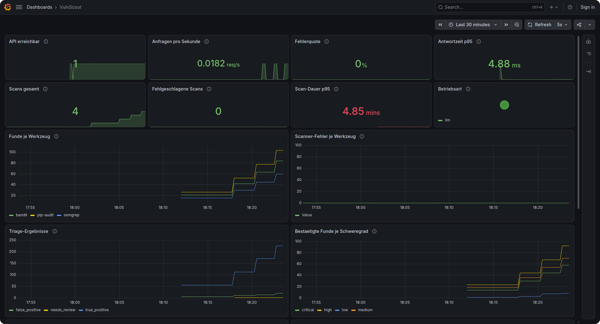

*Grafana, oben (Serie 2, 25.11.2026, vier Läufe im LLM-Modus gegen `dummy_vuln_repo`, Zähler zuvor durch API-Neustart zurückgesetzt): 4 Scans, 0 fehlgeschlagen. "Scan-Dauer p95" und "Antwortzeit p95" sind aus Histogramm-Eimern geschätzt, die tatsächliche Scan-Dauer lag zwischen 147 und 162 s. / Grafana, top (series 2, 25 Nov 2026, four runs in LLM mode against `dummy_vuln_repo`, counters reset by an API restart): 4 scans, 0 failed. "Scan-Dauer p95" and "Antwortzeit p95" are estimated from histogram buckets; actual scan durations were 147 to 162 s.*

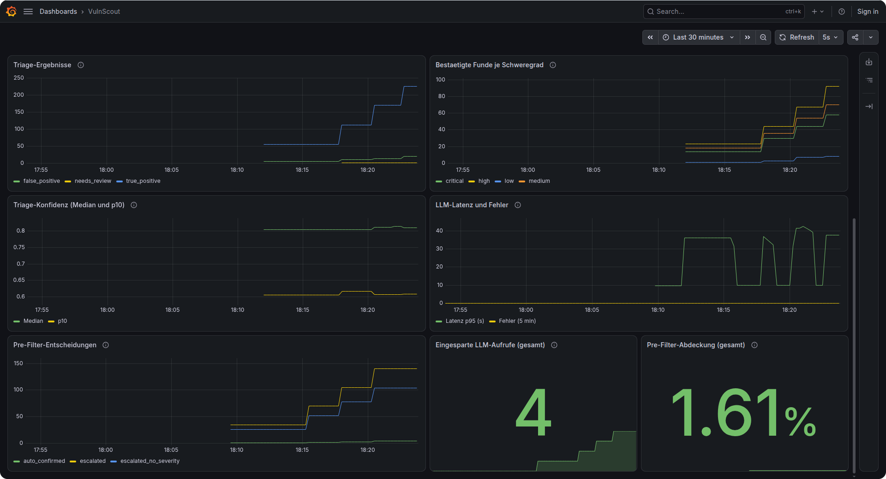

*Grafana, unten (dieselben vier Läufe): Triage 226 bestätigt, 20 Fehlalarm und 2 zur Prüfung (Summe der vier Läufe). Pre-Filter: 4 Funde automatisch entschieden und bestätigt (1 pro Lauf, gemessen), Abdeckung 1,61 %; die Kachel "eingesparte LLM-Aufrufe" (4) ist ein Schätzwert (ein Aufruf je automatisch entschiedenem Fund). / Grafana, bottom (same four runs): triage 226 confirmed, 20 false positives and 2 needing review (sum of the four runs). Pre-filter: 4 findings decided and confirmed automatically (1 per run, measured), coverage 1.61%; the "saved LLM calls" tile (4) is an estimate (one call per automatically decided finding).*

Besonders relevant ist der Alarm `ScannerFaelltAus`: Ein ausgefallenes Scanner-Werkzeug liefert keine Funde – im Bericht sieht das aus wie eine saubere Codebasis. Das Monitoring macht den Unterschied sichtbar.

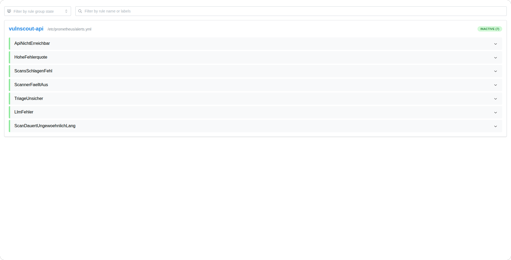

*Prometheus, 7 Alarmregeln aus `monitoring/alerts.yml`, alle inaktiv. Ein Alertmanager ist nicht angeschlossen (siehe Limitations). / Prometheus, 7 alert rules from `monitoring/alerts.yml`, all inactive. No Alertmanager is attached (see Limitations).*

**Einschränkung:** Die Kennzahlen leben im Arbeitsspeicher des API-Prozesses. Nur Läufe über `POST /scans` erscheinen unter `/metrics`; ein direkt per Kommandozeile gestarteter Lauf nicht.

`docker compose up` also starts Prometheus and Grafana alongside the API (ports 9090 and 3000). Metrics cover the four golden signals plus domain metrics: scans by outcome and duration, findings per scanner, scanner failures, triage outcomes, triage-confidence distribution, and LLM latency and errors. Note that metrics live in the API process, so only runs started via `POST /scans` are recorded.

## Pre-Filter-Modell / Kostenersparnis

Nicht jeder Scanner-Fund braucht einen LLM-Aufruf: Ein von pip-audit gemeldetes CVE ist praktisch immer ein echter Fund, ein Bandit-Treffer auf einen reinen Import praktisch immer ein Fehlalarm. Ein trainiertes Pre-Filter-Modell (`scripts/train_prefilter.py`) entscheidet solche eindeutigen Fälle direkt aus den Scanner-Merkmalen – ohne API-Aufruf – und reicht nur unsichere Fälle an die LLM-Triage weiter. Details zur Methodik (Repo-weiser Split, Qualitäts-Gate, Champion/Challenger in der MLflow Model Registry) stehen in [docs/architecture.md](docs/architecture.md#pre-filter-modell-srcprefilter-scriptstrain_prefilterpy).

**Wichtig, offen benannt:** Die Trainingslabels stammen vom Triage-Agenten (LLM) selbst, nicht von menschlicher Ground Truth – das Modell destilliert also das LLM-Urteil, es lernt nicht unabhängig "echte" Schwachstellen zu erkennen. Die unten berichtete Fehlerrate ist eine Abweichung vom LLM-Urteil, keine Abweichung von der Wahrheit.

Der Datensatz umfasst 3.004 reale Scanner-Funde aus 6 Repositories (4 bewusst verwundbare: eigenes Dummy-Repo, OWASP PyGoat, Vulnerable Flask App, DVPWA; 2 weit verbreitete Open-Source-Bibliotheken als Vergleichsbibliotheken: `requests`, `click`; ihre Freiheit von Schwachstellen ist nicht nachgewiesen). Davon dienen 1.402 Funde dem Training und 1.602 dem Test. `Vulnerable-Flask-App` und `click` wurden beim Training nie gesehen (repo-weiser Split, Testdaten). Das eigene Dummy-Repo gehört zu den Trainingsdaten und ist zugleich das Repo der Live-Auswertung unten.

Der Trainingsdatensatz (`scripts/training_data.jsonl`, 1,4 MB) liegt direkt im Repository, damit jeder das Modell ohne API-Kosten selbst trainieren kann (Anleitung im Schnellstart). Zum reinen Ausführen von VulnScout wird er nicht gebraucht – nur zum Trainieren des Pre-Filter-Modells.

| Kennzahl | Wert |
|---|---|
| Champion-Modell | Random Forest (Challenger: Logistic Regression) |
| Abdeckung auf den Test-Repos (automatisch entschieden, kein LLM-Aufruf) | **91,2 %** (1.461 von 1.602 Funden) |
| Abweichung vom LLM-Urteil bei den automatisch entschiedenen Funden | 0 von 1.461 (0,00 %); obere 95-%-Grenze nach der Dreierregel etwa 0,2 % |
| Qualitäts-Gate | < 2 % Fehlerrate – bestanden |
| Trainingsdaten / Testdaten | 1.402 / 1.602 Zeilen |
| Test-Repos | `click`, `vulnerable_flask_app` |
| Abdeckung im Live-Lauf auf dem Dummy-Repo, Serie 1 (24.11., 3 Läufe, 186 Funde) | **1,6 %** (3 Funde) |
| Abdeckung im Live-Lauf auf dem Dummy-Repo, Serie 2 (25.11., 4 Läufe, 248 Funde) | **1,61 %** (4 Funde) |

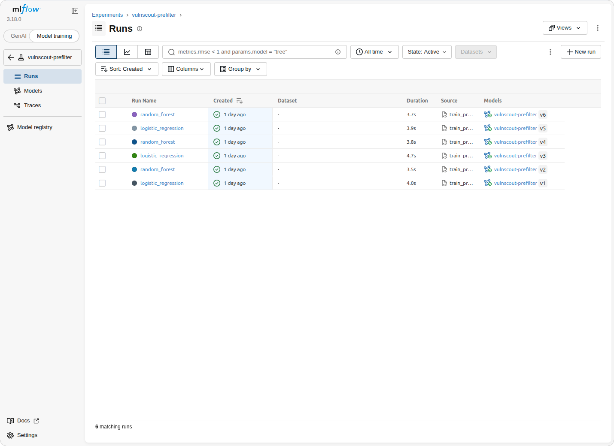

*MLflow, sechs Trainingsläufe (je drei random_forest und logistic_regression, 3,5 bis 4,7 s), registriert als Version 1 bis 6. / MLflow, six training runs (three each of random_forest and logistic_regression, 3.5 to 4.7 s), registered as versions 1 to 6.*

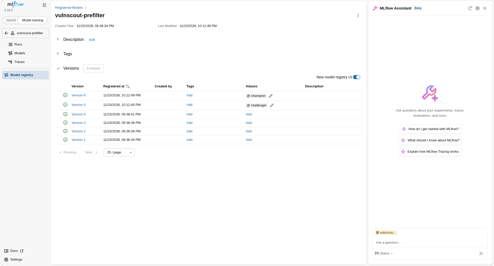

*MLflow Model Registry: `vulnscout-prefilter`, Version 6 trägt den Alias champion, Version 5 den Alias challenger. / MLflow model registry: `vulnscout-prefilter`, version 6 carries the alias champion, version 5 the alias challenger.*

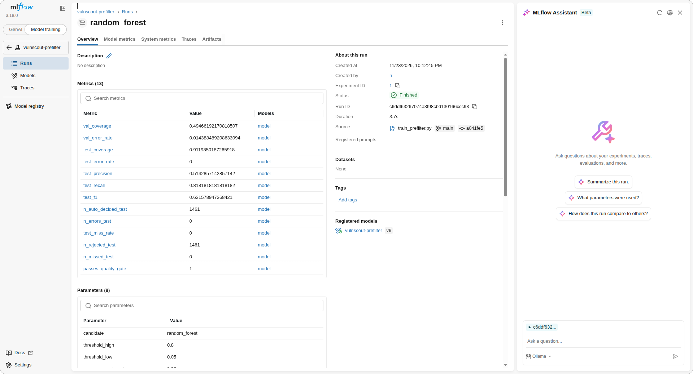

*Run random_forest (Version 6): test_coverage 91,2 %, test_error_rate 0, test_miss_rate 0, Qualitäts-Gate bestanden. Precision 51,4 %, Recall 81,8 % und F1 63,2 % sind einfache Klassifikationswerte des Modells ohne die Schwellen 0,8 und 0,05; für das Qualitäts-Gate zählen nur Fehlerrate und Miss-Rate. / Run random_forest (version 6): test_coverage 91.2%, test_error_rate 0, test_miss_rate 0, quality gate passed. Precision 51.4%, recall 81.8% and F1 63.2% are plain classification scores of the model without the thresholds 0.8 and 0.05; the quality gate only uses error rate and miss rate.*

91,2 % der Funde auf den beiden nie gesehenen Test-Repos wurden ohne LLM-Aufruf entschieden (alle als Fehlalarm verworfen), ohne dass eine dieser Entscheidungen vom LLM-Urteil abwich. Die übrigen 8,8 % gingen an die Triage. Das gilt für dieses Test-Set und gemessen am LLM-Urteil, nicht an unabhängiger Ground Truth.

**Im Live-Betrieb ist die Abdeckung deutlich niedriger:** Beim echten Lauf auf `dummy_vuln_repo` (Container, zwei unabhängige Serien) wurden nur 3 von 186 Funden (24.11., 1,6 %) bzw. 4 von 248 Funden (25.11., 1,61 %) automatisch entschieden. Der Hauptgrund: pip-audit-Funde haben keinen Scanner-Schweregrad und gehen per Regel immer an das LLM (78 von 186 bzw. 104 von 248 Funden). Die Kostenersparnis im Live-Betrieb ist damit klein; eine belastbare Aussage dazu steht aus. Die Abdeckung auf dem Test-Set (91,2 %) und die Live-Abdeckung (rund 1,6 %) haben unterschiedliche Datenbasen und sind nicht vergleichbar.

91.2% of findings on the two held-out test repos were decided without any LLM call (all rejected as false positives), with no deviation from the LLM verdict. This is measured against LLM labels, not independent ground truth. In two independent live series on the dummy repo (24 Nov 2026: 3 of 186 findings, 1.6%; 25 Nov 2026: 4 of 248 findings, 1.61%) only these few findings were decided automatically, because dependency findings carry no scanner severity and always go to the LLM; the cost saving in live use is therefore small.

## Tech-Stack

- Scanning: Bandit, pip-audit, Semgrep
- LLM: Anthropic SDK (Claude Sonnet 5.5, `claude-sonnet-5-5` als Standard, per `ANTHROPIC_MODEL` änderbar), strukturierte Ausgabe über Tool-Use
- Anreicherung: OSV.dev (Schweregrad-Angabe, CVSS-Vektoren, CWE)
- Pre-Filter-Modell: scikit-learn (Logistic Regression / Random Forest), MLflow Model Registry (Champion/Challenger)
- API: FastAPI
- Tracking: MLflow (Experiment-Tracking + Model Registry)
- Trainingsdaten: `scripts/training_data.jsonl` direkt im Repository (1,4 MB)
- Monitoring: Prometheus, Grafana
- Container: Docker, Docker Compose
- CI: GitHub Actions (`ci.yml`, Name `CI`), führt `pytest tests/` unter Python 3.11 bei Push und Pull Request auf `main` aus, inklusive Qualitäts-Gate-Test für das Pre-Filter-Modell. Kein Docker-Build, kein Deployment in der CI.
- Deployment der Demo: Render (Auto-Deploy bei neuem Commit), nicht Teil der CI: `ci.yml` enthält keinen Deploy-Schritt
- Persistenz: SQLite

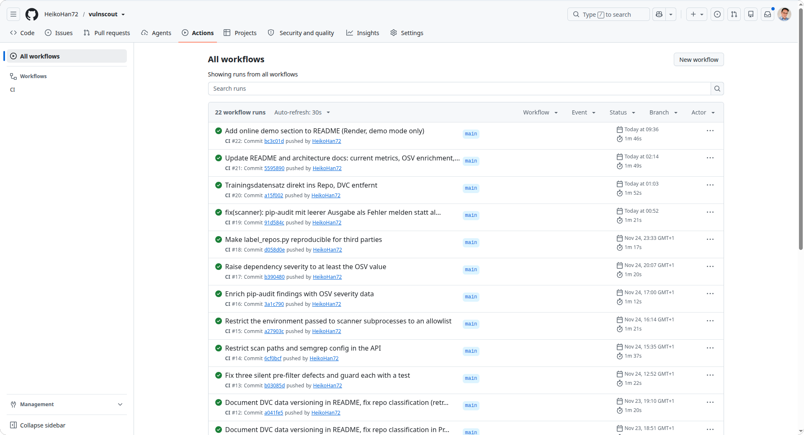

*GitHub Actions: CI #22 (bc3c01d) und #21 (5595890), beide grün (Stand 25.11.2026). / GitHub Actions: CI #22 (bc3c01d) and #21 (5595890), both green (as of 25 Nov 2026).*

## Evaluation

Getestet an:
- OWASP PyGoat
- Vulnerable Flask App
- DVPWA
- eigenem Dummy-Repo mit bekannter Ground Truth (`test_repos/dummy_vuln_repo`) – deckt u. a. SQL-Injection, Command Injection, Code Injection (eval/exec), SSTI, SSRF, XXE, Insecure Deserialization, Path Traversal, schwache Kryptografie, unsicheren Zufall, unsicheres YAML-Laden und verwundbare Dependencies ab, inklusive bewusst mehrdeutiger Fälle (z. B. `shell=True` mit hartcodiertem statt benutzergesteuertem Befehl) zum Testen des Triage-Consensus-Mechanismus

**Precision und bedingter Recall gegen echte Ground Truth** (`test_repos/dummy_vuln_repo/ground_truth.yml`, 17 bekannte Schwachstellenklassen + mehrdeutige Fälle + sichere Gegenbeispiele), gemessen mit `scripts/evaluate.py` an zwei unabhängigen Serien echter Läufe: Serie 1 mit drei Läufen vom 24.11.2026, Serie 2 mit vier Läufen vom 25.11.2026 (Scanner → Pre-Filter → LLM-Triage, kein Demo-Modus). Jeder Lauf hatte 62 Funde (Bandit 21, pip-audit 26, Semgrep 15) und dauerte in Serie 1 151 bis 160 und in Serie 2 147 bis 162 Sekunden. Zuordnung Fund → Ground-Truth-Eintrag über den Syntaxbaum, robust gegen Zeilenverschiebungen. Die Skript-Ausgabe jedes Laufs liegt unverändert unter [`docs/evaluation/`](docs/evaluation/).

| Bereich | Precision | Recall (bedingt) | F1 | richtig bestätigt | fälschlich bestätigt | richtig verworfen |
|---|---|---|---|---|---|---|
| Serie 1, 24.11. (Mittel der 3 Läufe, Spanne) | 92,5 % (90,6–93,5) | 98,9 % (96,6–100) | 95,6 % (94,9–96,7) | 28–29 | 2–3 | 3–5 |
| Serie 2, 25.11. (Mittel der 4 Läufe, Spanne) | 92,7 % (90,6–93,3) | 97,4 % (96,6–100) | 95,0 % (94,9–95,1) | 28–29 | 2–3 | 3–5 |

Dazu je Lauf 0 bis 1 fälschlich verworfener Fund und 0 bis 1 zur Prüfung offener Fund. Die Zahlen streuen, weil die LLM-Triage nicht deterministisch ist.

**Berechnungsgrundlage:** Bewertet werden die 36 Code-Funde von Bandit und Semgrep je Lauf (Abhängigkeiten werden getrennt ausgewertet, siehe unten). In allen sieben Läufen konnte jeder Code-Fund einem Ground-Truth-Eintrag zugeordnet werden. TP ist ein Fund, den die Ground Truth als echt führt und der bestätigt wurde, FP ein Fund, den sie als Fehlalarm oder unproblematisch führt und der trotzdem bestätigt wurde, FN ein echter Fund, der verworfen wurde. Precision = TP / (TP + FP), Recall = TP / (TP + FN), F1 = 2 * Precision * Recall / (Precision + Recall). Funde mit dem Ergebnis "zur Prüfung" (`needs_review`) zählen weder im Zähler noch im Nenner; sie sind weder als richtig noch als falsch gewertet (0 bis 1 Fund je Lauf). **Der Recall ist ein bedingter Recall:** Er gilt nur für die von den Scannern gemeldeten und bewerteten Code-Funde und sagt, welcher Anteil der darunter echten Funde von der Triage bestätigt wurde. Er ist nicht der Recall des Gesamtsystems. Die 3 Schwachstellen, die kein Scanner gemeldet hat, gehen nicht ein, weil dafür kein Fund existiert (siehe Limitations); ein Recall über alle 17 bekannten Schwachstellenklassen läge dadurch niedriger und wurde nicht berechnet. F1 ist aus Precision und diesem bedingten Recall gebildet.

**Abhängigkeiten (pip-audit):** 26 eindeutige Funde (pip-audit liefert jede Schwachstelle doppelt, 51 Einträge; gleiche Paket-Version-ID-Kombinationen werden zusammengeführt). In allen sieben Läufen (beide Serien) wurden alle 26 bestätigt. Diese Kennzahl misst nur, dass nichts verworfen wurde, und ist kein Qualitätsbeleg. Aussagekräftiger ist der Vergleich der Einstufung mit der OSV-Angabe: 26 von 26 stimmen überein (Übereinstimmung mit der Datenbank, kein Nachweis der Ausnutzbarkeit). Die Schweregrad-Untergrenze hat in diesen Läufen nichts angehoben (0 Anhebungen); ihre Wirkung im Live-Betrieb ist daher nicht belegt, sie ist durch Tests abgesichert.

Precision/recall against real ground truth, measured end-to-end (scanners → pre-filter → LLM triage, real LLM calls, no demo mode) in two independent series (three runs on 24 Nov 2026, four runs on 25 Nov 2026; 62 findings per run). Basis: the 36 code findings per run from Bandit and Semgrep; TP/FP/FN as defined by the ground truth, precision = TP/(TP+FP), recall = TP/(TP+FN), F1 = harmonic mean. The recall is conditional: it covers only the code findings reported by the scanners and evaluated by the triage, not the recall of the whole system. Findings left open for review (`needs_review`) count in neither numerator nor denominator. The 3 vulnerabilities no scanner reported are not part of this recall; a recall over all 17 known classes would be lower and was not computed. Reproducible after a real run against `test_repos/dummy_vuln_repo`:

```bash
docker compose cp api:/app/data/vulnscout.db ./lauf.db
python scripts/evaluate.py --db lauf.db --repo test_repos/dummy_vuln_repo
```

Zusätzlich wurden 6 Repositories (die vier oben plus `requests` und `click`) vollständig gescannt und von der LLM-Triage bewertet – **3.004 Funde**, als Datensatz für das Pre-Filter-Modell (`scripts/training_data.jsonl`, siehe oben). Hier gilt die LLM-Bewertung selbst als Zielgröße, nicht als unabhängige Ground Truth – die Distillation lernt, was das LLM sagen würde, nicht was objektiv wahr ist.

## Sicherheit / Security notes

- **Keine Authentifizierung:** Die API hat keine Anmeldung und ist im Compose-Stack nur an `127.0.0.1` gebunden. Sie ist nicht für den Betrieb in einem offenen Netz gedacht. Scanbare Pfade sind auf `VULNSCOUT_SCAN_ROOT` begrenzt (im Container `/app/test_repos`).
- **Scanner-Prozesse** bekommen nur eine minimale Umgebung (`PATH`, `HOME`, Locale, `TMPDIR`); der API-Schlüssel gehört nicht dazu.
- **Externe Dienste:** An die Anthropic-API gehen die Funde samt Code-Ausschnitten (nur im LLM-Modus, nicht im Demo-Modus). An OSV.dev gehen die Schwachstellen-IDs der Abhängigkeits-Funde; die Anreicherung ist über `VULNSCOUT_OSV_ENABLED` abschaltbar.
- **Prompt-Injection:** Code aus dem gescannten Repository landet im Prompt der LLM-Triage. Gezielte Tests dazu wurden nicht durchgeführt.
- **Geheimnisse:** Der API-Schlüssel gehört nur in die lokale `.env` (nicht im Repository, nur `.env.example`).
- **Öffentliche Demo:** Die Online-Demo ist ohne Anmeldung erreichbar; jeder mit der URL kann Scans der Beispiel-Repos starten. Sie enthält keinen API-Key und läuft im Demo-Modus. / The online demo is reachable without login; anyone with the URL can start scans of the example repos. It holds no API key and runs in demo mode.

## Limitations

- **Scanner-Abdeckung ist unvollständig:** Von 17 bekannten Schwachstellen im Ground-Truth-Repo haben Bandit und Semgrep (Regelwerk `p/security-audit`) 3 nie gemeldet – Path Traversal, SSRF und ein hartcodiertes Secret in der Config. Die LLM-Triage bewertet nur, was mindestens ein Scanner findet; sie meldet nichts selbst. **Ursache:** Beide Scanner arbeiten musterbasiert, nicht mit Datenfluss-/Taint-Analyse – SSRF und Path Traversal erfordern aber, Benutzereingaben über mehrere Zeilen bis zum gefährlichen Aufruf zu verfolgen. **Mögliche Abhilfe (nicht umgesetzt, Zeitrahmen des Projekts):** breiteres Semgrep-Regelwerk (z. B. `p/owasp-top-ten`) oder ein Tool mit echter Taint-Analyse (Semgrep Pro, CodeQL) ergänzen.
- **LLM-Triage ist nicht fehlerfrei und nicht deterministisch:** In den sieben Läufen (zwei Serien) wurden 2 bis 3 Code-Funde fälschlich bestätigt (z. B. harmloses `shell=True` ohne Benutzereingabe); Precision 90,6 bis 93,5 %, bedingter Recall (nur gemeldete Funde) 96,6 bis 100 %. Ein Temperatur-Parameter wird nicht gesetzt, die Ergebnisse streuen von Lauf zu Lauf. Sieben Läufe in zwei Serien sind eine kleine Stichprobe.
- **Pre-Filter-Modell ist Distillation, keine unabhängige Verifikation:** Es lernt, die LLM-Bewertung vorherzusagen, nicht die Wahrheit selbst. Ein systematischer Fehler der LLM-Triage würde vom Pre-Filter übernommen statt korrigiert.
- **Pre-Filter: Zahlen nicht unabhängig geprüft:** Die Abdeckung von 91,2 % und die Abweichung von 0 gelten gegenüber dem LLM-Urteil auf zwei Test-Repos. Klassenverteilung im Test-Set, einfache Vergleichsmodelle (Baselines) und mögliche Überschneidungen zwischen Training und Test wurden nicht untersucht. Im Live-Lauf lag die Abdeckung in beiden Serien bei rund 1,6 %, und das Dummy-Repo steckt im Trainingsdatensatz.
- **Semgrep-Regelkennungen im Training weichen ab:** Die 214 Semgrep-Zeilen im Datensatz stammen von einem lokal geklonten Regelwerk, im Betrieb liefert `p/security-audit` andere Kennungen. Auf 23 ausgehaltenen Semgrep-Zeilen traf der Pre-Filter dadurch keine automatische Entscheidung; das ist nur eine kleine Stichprobe, geprüft für das Champion-Modell.
- **Trainingsdatensatz für den Pre-Filter ist klein und Python-only:** 3.004 Funde aus 6 Repositories, ausschließlich Python. Für andere Sprachen oder stark abweichende Codebasen ist keine Aussage über die Pre-Filter-Qualität möglich.
- **Quell-Commits der Trainings-Repositories nicht festgehalten:** `scripts/label_repos.py` klont die sechs Repositories flach (`--depth 1`) und speichert nicht, welcher Commit gescannt wurde. `scripts/training_data.jsonl` ist damit nicht bit-genau reproduzierbar: ein erneuter Lauf kann bei geänderten Upstream-Repositories andere Funde liefern, zusätzlich ist die LLM-Beschriftung nicht deterministisch. Die vorhandene Datei liegt im Repository und ist die Grundlage aller berichteten Zahlen.
- **Das Pre-Filter-Modell ist nicht im Repository:** Es entsteht erst durch das Training (Schnellstart) und liegt dann in der MLflow Registry des eigenen Compose-Stacks. Ohne trainiertes Modell läuft VulnScout im Rückfallbetrieb: Jeder Fund geht an die LLM-Triage, die Kostenersparnis entfällt. Der API-Prozess lädt das Modell beim ersten Scan; wurde danach trainiert, ist ein `docker compose restart api` nötig.
- **Hinter einem Proxy** fehlen die Proxy-Variablen in den Scanner-Prozessen: pip-audit meldet dann einen Scanner-Fehler (sichtbar im Bericht, in der Datenbank und in der Metrik `vulnscout_scanner_errors_total`) und liefert keine Abhängigkeits-Funde; Bandit und Semgrep laufen weiter. Nicht getestet unter Windows und macOS.
- **Schweregrad-Untergrenze live ungeprüft:** Sie hat in allen sieben Live-Läufen nichts angehoben; ihre Wirkung ist nur durch Tests belegt.
- **Kein Alertmanager:** Die 7 Prometheus-Alarmregeln werden ausgewertet, aber nicht versendet – nur in der Prometheus-Oberfläche sichtbar.
- **Kein asynchrones Scanning:** `POST /scans` läuft synchron, ein Scan pro Request.
- **Bekannte API-Einschränkung:** Bei Fehlschlag von `POST /scans` fehlt die Lauf-ID in der Fehlerantwort.
- **Die Online-Demo zeigt nicht die KI-Qualität:** Sie läuft im Demo-Modus (Fixture-Triage, kein Pre-Filter, keine MLflow Registry). Die Kennzahlen in diesem README stammen aus lokalen Läufen mit Anthropic-Key. / The online demo does not show the AI quality: it runs in demo mode (fixture triage, no pre-filter, no MLflow registry). The figures in this README come from local runs with an Anthropic key.

*English summary: scanner coverage is incomplete (3 of 17 known vulnerabilities were never flagged by Bandit/Semgrep, because both are pattern-based rather than taint-analysis tools; a broader ruleset or a taint-analysis tool such as Semgrep Pro or CodeQL would address this but was out of scope given the project timeline); LLM triage is non-deterministic and confirmed 2-3 false positives per run (precision 90.6-93.5% on code findings over seven runs in two series); the training data does not record the commits of the cloned source repositories (shallow clones), so the dataset cannot be regenerated bit-for-bit; the pre-filter model is a distillation of LLM judgment, not independent ground truth, so it inherits any systematic LLM bias; its 91.2% coverage on held-out repos was not independently validated and drops to about 1.6% in live runs on the dummy repo; its training data (3,004 findings, 6 repos) is Python-only; behind a proxy pip-audit reports a scanner error and returns no dependency findings; tested on Linux only; no Alertmanager wiring; scanning is synchronous; a failed `POST /scans` doesn't return a run id.*

## KI-Einsatz / AI Assistance

Bei der Entwicklung dieses Projekts wurden KI-gestützte Werkzeuge gezielt als Entwicklungs- und Analyseassistenten eingesetzt. Claude (Anthropic) kam insbesondere bei Architekturüberlegungen, Implementierung von Programmcode, Entwicklung und Überprüfung von Tests, Fehlersuche, Analyse von Messergebnissen und technischer Dokumentation zum Einsatz.

Die Projektkonzeption, die Festlegung des Funktionsumfangs und die wesentlichen technischen Entscheidungen lagen beim Autor. Bei der Datenbasis legte der Autor den Ansatz fest (bestehende Repositories aus Git übernehmen, ein eigenes Testrepo erzeugen); die Suche nach geeigneten Repositories erfolgte mit Claude. Ebenso erfolgten die fachliche Bewertung der Ergebnisse sowie die Entscheidung über die Übernahme und Freigabe der Implementierungen durch den Autor.

Die Implementierungen wurden lokal ausgeführt und überprüft. Der Autor führte die Tests sowie sämtliche Schritte des Frisch-Klon-Tests (Klonen, Bauen, Training und Scans) auf dem eigenen Rechner durch. Die Mutationsprüfung der Tests und die Auswertung der Messdaten wurden unter Einsatz von Claude durchgeführt und vom Autor bewertet. Die Versionsverwaltung und Übertragung der Änderungen in das Repository erfolgten durch den Autor mittels Git.

Das Coverbild wurde mit ChatGPT (OpenAI) auf Grundlage einer Vorgabe des Autors KI-generiert.

## Lizenz / License

MIT – siehe [LICENSE](LICENSE).
